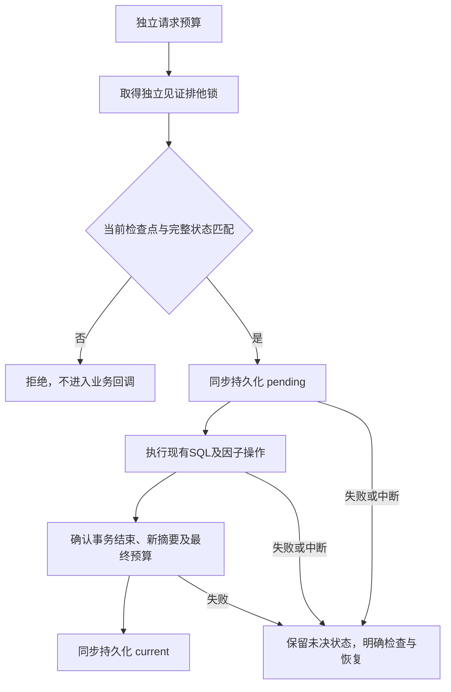

# 完整旧备份的新鲜度与安全代际

状态：实施中，主SDK尚未关闭此风险。独立新因子恢复已经接入，不等于完整备份防回滚。本文区分已复现行为、隔离见证原型及仍须交付的接入与恢复契约。

## 已确认的行为

本地合成账号真实登录后，恢复码轮换推进凭据版本，旧会话随后被拒绝。恢复全部原始SQL数据及会话／因子FileStore文件，保留外部open工作进程栅栏和当前配置epoch，原会话重新通过。PHP7.2／8.5均已取得准确副作用标记，证据见[验证记录](verification.md)。仅恢复SQL、保留已观察撤销的当前会话存储时仍拒绝，不能用这个较窄对照证明完整备份安全。

HMAC认证数据来源与完整性；一个完整有效旧备份仍可以拥有正确的HMAC、历史集合和版本。工作进程栅栏阻止已关闭的旧进程权威，却不会自行记录每次普通凭据／会话变化后的最新状态。两者都不能代替独立的新鲜度来源。

## 隔离状态见证原型

`/tmp/sosecurity-factor-freshness-u4qhnsjx/src/Account/LocalStateWitness.php` 尚未接入发行包或公开API清单。它用独立私有本地目录中的签名检查点记录完整受保护状态的摘要，同一上下文的完整操作持有排他锁。独立请求预算在受保护状态读取前执行；最终预算之后再次核对实际状态。它不授予业务权限，现有服务的账号、对象授权、强审批与预算继续执行。

操作前pending必须先确认持久化，才能进入业务回调。异常或进程被杀后，即使SQL已经回滚或旧状态与原摘要一致，也不自动清除未决状态。成功回调返回后，仍须确认宿主事务已经结束、取得新的完整摘要并持久化检查点。最终检查点写入的回执不确定时报告 `account.completion_unknown`；当前文件可能已经是新current，调用方须检查，不能据异常自动重放。现有宿主事务不会被接管、提交或回滚。

首次创建仅允许受控部署使用已独立确认的期望摘要；文件缺失、已有、损坏、被替换、硬链接、权限异常或超长均拒绝，不能将重新初始化作为修复。签名绑定站点／作用域／epoch和准确目录身份。持久化回调必须真正同步文件及必要目录元数据；本地测试使用自有文件描述符和目录执行真实fsync。该模型依赖不会随业务备份恢复的独立权威，不覆盖管理员同时回滚独立权威、多节点共识或不符合本地锁／持久化语义的文件系统。

原型的九版45条检查、两个私有MySQL组及两个准确危险副作用反例已有证据。实际完整旧备份在进入认证回调前拒绝；真实子进程的暂停、继续及SQL提交前后SIGKILL保留未决状态。测试用摘要适配仅处理固定有界合成数据，不是正式宿主适配，不应复制到生产。

## 强类型 SQL 状态来源候选

`/tmp/sosecurity-state-snapshot-y70ghjk4/acceptance.json` 记录了尚未接入的 `StateSnapshot`、`SqlStateSnapshot` 及见证绑定改造。来源必须持有准确同一 PDO，并声明固定表、完整字段、实际主键、固定筛选值与最大行数；连接或覆盖指纹变化时在委托读取前拒绝，不能重新采用旧检查点。完整字段清单与实际结构逐项核对，遗漏密码字段、额外字段或主键不符均拒绝。

SQL 端先检查存储类型与实际字节数，再返回有界值；原始字节使用长度分帧摘要，区分 NULL、空值、NUL 后内容与非 UTF-8 数据。正文能力保留至 1MiB，每页缓冲约束与按实际主键翻页共同限制内存；一万条实际记录在 8MiB PHP 限制内完成摘要，查询计划不使用临时排序。SQLite 通过当前事务的 `BEGIN IMMEDIATE` 阻止并行写入，MySQL 要求显式 REPEATABLE READ，实际独立连接在两页之间提交前页／后页修改和新增行时，本次摘要仍保持原完整代际，下一次读取才观察新状态。

开发中确认 BLOB 筛选参数按文本绑定会在 SQLite 静默漏选，已改成依据字段声明绑定 BLOB。新增空值、NUL、非 UTF-8 筛选对照；准确旧实现运行新增测试时失败。最终九版 PHP 共63条核心／语法检查、九次共享数据摘要对照与九组分页一致性补测通过，每版111项运行断言；两版私有无TCP MySQL共十组、每版90项通过，实例已清理。263份已冻结相关程序文件哈希保持，目标PHP7.2 level5静态通过；初版分页测试误判 SQLite 并行写语义及静态命令路径错误均保留，没有算作通过。

这只完成该阶段的 SQL 部分；下述物理与组合来源是后续独立候选，不把两个阶段合并成同一源码快照。当前 SQLite 声明只接受准确 INTEGER／TEXT／BLOB；真实宿主审计表使用的 VARCHAR／INT 等声明仍须显式适配并验证，不能直接放宽成任意SQL类型。

## 有界物理与组合来源候选

`/tmp/sosecurity-file-snapshot-j1piv3sz/acceptance.json` 记录新增的 `FileStateSnapshot` 与 `CompositeStateSnapshot`，均未接入SDK。物理来源绑定准确私有目录身份，完整扫描FileStore状态文件的原始字节，永久锁条带只验证结构而不算作认证状态；不按过期时间忽略文件。只接受准确文件名、0600普通单链接文件及0700目录，拒绝符号链接、硬链接、目录替换、超出64KiB的状态文件和遗留写入临时文件。正文读取前后核对文件描述符与路径身份，读取保持有界；原始摘要不是JSON或业务签名验证的替代品。

文件名与每文件摘要每256条形成排序段，在独立私有临时目录中最多16路归并；整个目录的文件名列表及正文不会一次装入PHP。最大声明为一百万份状态文件，具体操作仍有时间预算；一万份真实文件以打乱创建顺序运行，所得摘要与独立顺序生成的参考值一致，重复运行、容量拒绝及临时目录清理均在8MiB限制下验证。此来源只面向符合本地文件语义的FileStore，不自动声称Redis、网络文件系统或多节点适用。

组合来源固定同一PDO、名称及覆盖指纹，连续两轮完整采集必须一致；组件改变连接或覆盖时在委托前拒绝。SQL或物理状态单独变化都会改变组合摘要；见证确认新SQL／会话状态后，联合恢复合成SQL与FileStore原字节可重现原摘要，但会被独立见证在业务回调之前拒绝。两轮对照不能代替全部写入者持有同一外部排他权威；任意绕过登记的写入仍属于未完成的接入边界。

最终九版117条核心／语法、两类共享数据18次摘要对照、两版私有无TCP MySQL12组和专项静态通过，每版SQLite185项、MySQL110项；269份冻结程序哈希保持。只在本地隔离数据上验证，实例清理。刻意把每文件摘要截断在NUL前的退化实现按预期触发失败。初版参数绑定错误及静态冗余类型检查保留历史日志，未计作通过。真实认证／因子／会话完整备份的强类型宿主配置、全部入口、未知结果独立审批与安全代际迁移仍未完成，不能当作主SDK防回滚已修复。

## 固定宿主配置下的真实认证备份验证

`/tmp/sosecurity-auth-snapshot-7itc8d6m/acceptance.json` 使用固定声明的六张账号／迁移审计／账本／Outbox表及实际会话、因子FileStore，不再使用早期测试用的推断式摘要帮助方法。真实密码与TOTP登录后，分别执行恢复码轮换、独立会话撤销，确认旧会话已拒绝；准确恢复原始SQL字段类型及全部文件字节，核对原始组合摘要重现后，由独立见证在认证回调前拒绝。两版去掉新鲜度比较、或者只保护SQL而省略物理会话状态的反例均实际重新认证旧会话，分别保留危险副作用标记。

SQLite宿主VARCHAR／INT等声明须显式提供完整 `sqlite_declarations`，逐字段精确核对并计入覆盖指纹，不能在运行时自动猜测；这些声明不替代实际类型及字节检查。SQLite不会依据VARCHAR括号中的数字限制实际长度，见[官方类型说明](https://www.sqlite.org/datatype3.html)。另已确认仅绑定字段类型与主键不足以发现排序规则变化：相同字段字节、不同COLLATE规则可改变实际查询结果。候选追加有界的表／索引／持久及临时触发器定义摘要，每项最多16KiB、最多128项，超限在SQL返回正文前拒绝。未把其他临时同名表误当作受保护的main表。

该阶段九版153条及九次共享摘要、两版MySQL18组、静态均通过，355份冻结程序保持；每版SQLite252项、MySQL137项，实例清理。PHP8.5初轮因分配器预留量恰为8MiB、实际峰值约3.8MiB触发原先严格小于8MiB的断言，诊断与失败保留；最终允许预留量等于已强制的8M上限，同时核对实际用量和有效运行时限制，没有提高内存额度。

这仍是隔离候选验证。该阶段发现的非UTF-8目录指纹编码及组合构造参数数组引用问题，已在下述后续候选修正；不能据早期快照称为可发布来源。全部入口、请求权限／副作用边界及强审批安全代际恢复尚未接入，主SDK风险保持未关闭。

## 来源上下文与构造引用修正

`/tmp/sosecurity-state-context-9x0z0k2n/acceptance.json` 是上述来源的当前隔离候选。文件目录按原始字节编码计入格式2覆盖指纹，避免非UTF-8路径使JSON编码失败而丢失身份；保留这类合法本地路径能力，不将其简单禁用。同一PDO下、内容相同的两个不同二进制目录不能采用对方的独立检查点，旧实现的真实业务回调曾能执行，现按缺失对应权威拒绝。新指纹与旧原型不兼容，不能静默采用旧检查点，必须走既定受控首次配置或后续尚待完成的独立审批迁移。

组合来源逐项复制组件引用；调用方替换或删除原数组的引用元素，不改变已捕获的提供器。提供器对象自身连接或覆盖变化的检查仍保留，复制数组不意味着信任可变覆盖。两版准确旧实现分别触发权威被错误采用及构造引用改变的副作用标记，均按预期失败。

最新九版171条检查、SQL／文件两类共享摘要18次及静态通过，每版SQLite266项，358份冻结相关程序保持；两版私有MySQL18组、每版137项通过并清理实例。初轮PHP7.2—7.4的三组二进制目录测试未设置PDO异常模式，已显式设置并重跑九版完整矩阵，运行时代码保持。MySQL已通过的命令未加载该SQLite测试，实际代码和依赖无变化，旧测试文件已归档并保留准确清单，未把不同全文件清单说成同一份。

这完成了强类型来源、受控真实认证备份和上下文边界的候选验证，尚未完成主SDK强制接入或防回滚交付。全入口覆盖、权限／副作用阶段、未知结果强审批与安全代际、其他物理后端及正式工厂／运维／消费者门禁继续。

入口与实际存储访问的后续接入候选见[入口边界](account-state-entries.md)，不把来源摘要与调用方手工包装等同于全部入口已保护。

## 尚须完成的接入

1. 定义强类型、同PDO、有界并可跨PHP版本复算的状态来源。覆盖账号实际凭据、目录与工作流、物理因子、会话撤销及其他认证关键状态；不能只摘要SQL中的版本、只依赖某次登录的缓存，或遗漏可恢复的撤销状态。合法数据上限沿用各组件契约，测试预设环境的限额不能成为正式能力的缩减。
2. 将全部认证、凭据修改、因子管理、恢复、维护、清理及后台写入接入同一套权威边界，保持明确锁顺序。遗漏写入者必须停止或拒绝，不能在无法确认覆盖时自动采用新的当前摘要。会话验证及存储清理可能写状态，也需要纳入。
3. 将输入与当前权限校验同可能产生副作用的阶段明确分离。原型对进入pending后的异常采取保守阻断，不能直接作为所有公开请求的包装器；应防止普通非法请求或权限拒绝无故封闭整个作用域，同时保留提交不确定时的阻断。
4. 完成未知结果的独立强审批恢复与安全代际迁移。批准的数据必须绑定准确未决操作、当前状态、原独立根及明确安全效果；不能把“当前数据库恰好可读”当作可以采用的依据。旧凭据、会话、恢复码、待处理授权及旧工作进程不能随旧备份重新生效。
5. 完成多账号／多用途并发、容量、密钥更换、完整备份恢复及操作中断验证，并接入工厂、诊断、原生管理流程、消费者和当前完整门禁。

这些事项完成前，原始完整旧备份风险仍为未关闭，R1.4、完整R2.7及R1—R6总目标保持进行中。
