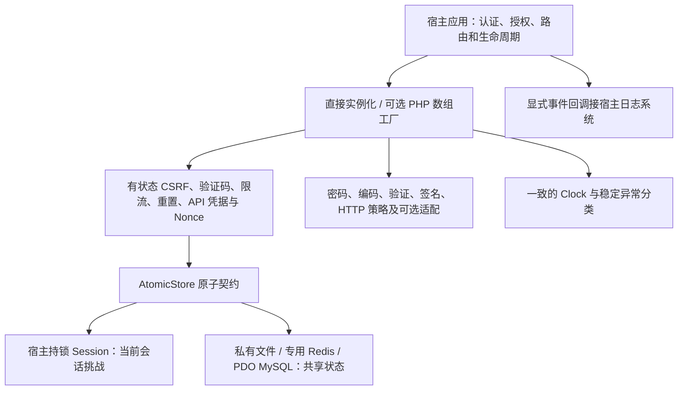

# 架构决策

## 组件依赖关系

状态类共用契约，但不强制所有组件使用同一物理后端。签名端/无状态CSRF不要求令牌存储；宿主继续决定认证、业务写入和HTTP响应。

## ADR-001：单包、按需实例化

`SoSecurity\` 使用 PSR-4。无全局启动器、路由、数据库 ORM 或认证系统；安装后不会改变应用行为。PHP 7.2 语法是核心基线；不使用属性类型、箭头函数、联合类型或 PHP 8 专用 API。开发工具使用独立 tools Composer 项目，避免现代静态分析工具阻断旧版 PHP 的运行时安装。

核心依赖只有 PHP 内置能力，无必须安装的大型框架和密码学库。密码使用 `password_hash/password_verify`，随机数使用 `random_bytes/random_int`，固定格式摘要比较用 `hash_equals`。HMAC使用原生hash_hmac及有明确边界的签名配置档，不自行设计密码算法；高级认证能力保持可选。

## ADR-002：一个原子存储契约

`AtomicStore::transact(key, callback)` 原子读取有效状态、调用纯状态转换、提交后返回结果；回调返回 `Change(value, expiresAt, result)`。null 删除，expiresAt=0 为永久。Redis 冲突可能重试，所以回调不能发邮件、记日志、调用网络或产生随机数；随机令牌在事务外生成。

FileStore：应用拥有的 0700 私有目录，数据 0600，64 个永久锁文件；锁内读取与临时文件原子 rename；清理也持有同一个锁，永远不删除锁文件。只支持本地文件系统，不承诺 NFS、多主机或断电持久性。

RedisStore：专用 phpredis 连接，禁止序列化器和客户端前缀；原子Lua CAS（compare-and-swap）提交，有界网络等待、总重试预算及TTL；避免Redis旧版WATCH不因过期中止的差异。不同站点显式 namespace；不调用 FLUSHDB。生产实例必须禁止安全状态被逐出（noeviction），配置访问控制、容量告警和持久性。被清空的安全状态无法仅凭库端识别。

SessionStore：宿主先启动并持有 Session 锁；只修改自己命名空间，清理过期记录并限制记录数量。只能用于当前会话验证码/CSRF；不能用于跨会话登录限流。自定义 Session 驱动必须提供真实互斥锁；本库不能自动证明第三方驱动具备该性质。

MemoryStore：仅用于测试，不用于生产共享安全状态。所有适配器遇到存储/编码错误抛异常，宿主拒绝敏感操作，不能切换到空内存数据。

## ADR-003：有状态令牌及有界容量

CSRF 是 256 位随机令牌，存储摘要。key 由模块、长度前缀作用域、服务器侧绑定组成，不暴露 Session ID。每桶最多 64 个令牌，默认16；每表单新发令牌，未超容量时互不作废。普通表单允许在有效期内重用；转账等敏感操作可选原子单次消费。重置令牌复用生命周期但使用独立作用域和账号密码版本绑定。

验证码按同样的绑定划分桶：随机 ID、摘要、过期和错误预算，最多16个并存。摘要不是低熵答案的加密，读取存储的攻击者可能枚举答案，因此存储始终须保密。答案不放入 Challenge 的公开属性。刷新先 revoke；创建与验证入口应分别限流。

暂不提供“纯前端验证”或不绑定会话的双重 Cookie CSRF。成熟框架已有 CSRF 时优先沿用框架。

## ADR-004：验证密码前预占额度

只在失败后计数，会让同时到达的请求全部先执行昂贵密码验证。`consume` 在验证前原子预占次数，允许 limit 个请求，第 limit+1 个拒绝并触发阶梯封禁；封禁期间拒绝不会延长封禁。固定窗口（fixed window）边缘可能允许近两倍的短时流量，配置必须据此留余量，后续有实际需求再增加滑动窗口。

成功登录默认不清除计数，避免攻击者持有一个有效凭证而清除共享 IP 的攻击预算。reset 作为显式管理动作。按单账号永久自动封禁容易成为攻击者锁死用户的工具，示例采用 IP+规范化账号，IP 总量桶阈值更宽松。

## ADR-005：PHP 7.2 与现代密码算法

可移植默认 bcrypt cost=12；新环境显式选 Argon2id（至少19 MiB、两轮）。不支持的环境抛错，不偷偷改用其他配置。bcrypt 最多72字节，超过时拒绝而不是截断；Unicode 长度策略与字节限制分别检查。不自动将 Argon2 哈希降级成 bcrypt。

旧哈希只能由宿主提供准确验证器，验证成功后返回新哈希，宿主通过 compare-and-swap 更新原值；本库不自动猜测 MD5/SHA1 格式。超过目标算法限制的旧密码无法自动迁移，需改用可用 Argon2id 或受控重置，不可截断后迁移。

## ADR-006：宿主控制会话和 HTTP 策略

不会自动 session_start、替换认证字段或注册中间件。configure 在启动前调用；rotate 由登录/权限变化的调用点触发。touch 返回 false 后保持失效，宿主负责退出认证，不能忽略返回值。PHP 7.2 原生 Session 没有 SameSite 配置项，显式生成合法 Set-Cookie 头，避免把 SameSite 注入 cookie_path。

CSP 默认 Report-Only，HSTS 必须显式启用；示例不强加严格 CSP 或 includeSubDomains。输出编码按上下文设计，不提供“万能清洗”。可信代理默认空，只处理部署中明确允许的 X-Forwarded-For 链。

## ADR-007：不可变配置、时间预算和可选工厂

Policy与Change不再公开可写字段，读取使用方法。配置工厂校验PHP数组，未知项拒绝，按需创建服务，共用Clock；构造不启动Session、发送响应头或连接网络。核心组件保留独立使用方式。自定义存储必须满足原子契约，工厂不把Memory/Session误用于跨会话限流。

文件锁使用LOCK_NB和默认1000ms等待上限；分批清理只在同一实例内继续游标，不删除永久锁。Redis每次命令受剩余预算约束，默认总1000ms和32次CAS重试。PHP7.3+使用hrtime；PHP7.2使用microtime并对时钟倒退立即过期。执行中的业务回调不能被强制抢占，但超预算后不能提交。

phpredis4.3在connect时的默认read_timeout=0使用PHP socket默认值，而之后setOption(0)会产生立即超时。适配器使用字符串形式设置有界超时，恢复有效的有限socket默认值。网络异常后关闭连接并使实例失效；调用者显式重连并重建，不能借扩展自动重连掩盖不确定提交。

重置宿主示例以SQL版本CAS限制并行旧令牌；不拥有宿主事务。保存成功后清理失败必须报告已写入且待清理，不假称未修改。完整进度与剩余验收见execution-status.md。

## ADR-008：Redis进程身份与显式恢复

ready绑定run_id与随机epoch，提交Lua内部再次核对，避免旧快照恢复一次性令牌。构造/请求不初始化；可信部署脚本显式初始化，重启恢复需运营者审核并换epoch。重置安全状态不是无损恢复，旧封禁和永久键由运营者处理；单键删除、同进程导入和Cluster不在已验证范围。

## ADR-009：MySQL事务所有权与逻辑删除

独立InnoDB表、唯一主键占位及行锁负责原子性；已有宿主事务直接拒绝，只提交/回滚本库事务并恢复会话锁等待设置。短暂空载荷记录避免消费时删除/再插入的间隙锁争用；提交不确定时拒绝而不自动重试。数据库端先限制返回载荷长度，防止损坏MEDIUMTEXT先在PHP内完整加载；清理核对JSON和索引过期时间。

## ADR-010：严格有界输入验证

schema来自可信代码，拒绝未知字段，不自动类型转换或清洗HTML。正常失败返回路径/code；只有全部通过可读取data。Unicode长度按码点，NFC显式启用并要求intl；遍历和schema都设结构/字节预算。自定义规则接口保持小且框架无关，异常不能当成功；业务授权、输出编码、SQL和HTTP解析预算仍由宿主负责。

## ADR-011：上传检查与保存分开，使用受限内容快照

原生上传检查PHP provenance，文件管理器仅使用已授权本地源；两者都读取有界普通文件快照。扩展/MIME匹配、图片预算与实际解码/重新编码完成后扫描同一快照，再用排他随机名称私有保存。Saver不接受调用者构造的Candidate绕过校验；结果只在完成写入后返回，源文件不删除。宿主负责授权、CSRF、整体配额、保留和公开下载。PHP7.2 WebP由专用私有临时快照解码，不打开任意URL、不重读原始源；新的GdImage依赖对象生命周期，避开PHP8.5废弃的imagedestroy调用。

演示另有容量/访客配额、有限扫描清理、私有文件夹和Apache请求体限制，没有公开下载/执行路径。SDK默认不连接AV；固定故障实现与真实扫描服务状态明确分开。

## ADR-012：HTTP策略纯函数与有界受限客户端

共享严格HTTP URI用于跳转/CORS/请求和URL输入格式，但格式不等于访问许可。跳转绑定可信Origin并返回绝对Location；CORS/权限头显式使用，不接管认证或改变已有站点默认策略。

受限客户端以精确host/port和保守公开地址为边界，每跳重新验证全部A/AAAA并固定实际连接。默认Google兼容JSON DoH避免原生阻塞DNS脱离总预算，bootstrap pin和TLS验证使解析器本身没有第二次未检查解析；第三方DNS隐私/自定义有界契约必须公开说明。Transport禁用代理/自动跳转/netrc/cookies，在读取时限额；跨来源丢弃应用头，POST不自动重放。命名空间TLS测试仅更改隔离网络和每进程CA，不能用模拟peer当真实传输验收。

## ADR-013：Bearer 摘要与 RFC 9421 有界 HMAC 配置档

随机 Bearer 的 ID/256 位秘密与生命周期仅存摘要；HMAC 使用独立的宿主私有原文密钥，身份/精确范围由 KeyProvider 提供。配置档固定方法/完整 URI/原始体摘要/Content-Type、参数顺序、算法/tag，采用 RFC 9421/9530 标准表示但拒绝其他配置档，避免自创无互操作证据的连接字符串协议。

时间/摘要/密钥/范围/MAC 全通过后才由共享 AtomicStore 原子登记 Nonce；保留到 expires+skew+1 覆盖最后接受秒，锁等待后过期仍拒绝。Nonce 不代替业务幂等性或资源归属，未知密钥/无效签名不能填满 Nonce 存储。生产宿主负责入口限流、原始请求边界、TLS、密钥撤销传播、恢复后失效以及容量；工厂拒绝非共享的内存/Session。独立 Python 向量、RFC 公布原语、真实本地 HTTP 和三驱动并发提供有界证据，独立审计/生产客户端仍须另行验收。

## ADR-014：无状态CSRF不代替令牌存储的单次消费

SignedTokens使用独立私有HMAC密钥、当前已验证且每次登录唯一的绑定、固定站点/场景以及随机值；长度前缀计算真实字节，身份不放入公开令牌。签名双重提交要求Cookie和显式提交值一致，再验证绑定/MAC。期限为额外使用窗口，不代替宿主认证寿命；保持多标签页时复用仍有效的Cookie token，不延长原签名期。密钥快照最多8把，轮换/撤销传播由宿主完成；没有令牌状态，也没有单次消费或逐令牌撤销承诺。高风险单次操作继续原子CsrfTokens，不在存储故障后自动切换。

RequestPolicy仅精确匹配固定方法/纯ASCII规范路径，拒绝glob/编码别名配置，不注册路由或授权业务。读取方法必须无写操作，签名API/webhook豁免仍需真实认证。独立Python长度前缀向量、无PHP Session的真实HTTP以及私有TLS/浏览器验证提供有界证据；生产身份/代理和独立复核仍须另行验收。

## ADR-015：HTML清理由成熟可选实现承担，外层限制资源/上下文

普通输出编码与富文本清理保持独立。默认HTMLPurifier适配固定基础标签/协议/属性，无CSS/图片/嵌入资源/可信HTML/任意provider hooks；DOM资源预检只限制树/属性和队列，原始输入仍交上游处理，输出不截断并再次校验预算/编码。默认定义缓存关闭，缺失/旧版本依赖与故障均拒绝，不以原文/strip_tags/正则作为备用清理。

核心只建议安装可选依赖，独立integrations/htmlpurifier清单/lock只供验证及演示并排除发行包。诊断不调用适配或自动加载依赖，custom接口仍需宿主证明安全策略，正文渲染之外不授予可信标记。DOM/ctype扩展只约束此模块；libxml错误模式保留且可能追加解析诊断，不声称进程级隔离或硬CPU沙箱。
