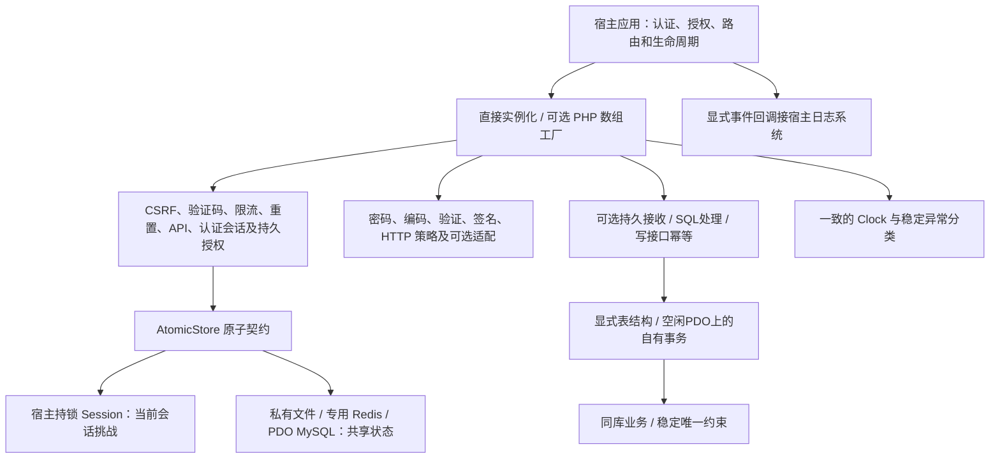

# 架构决策

## ADR-033：原生恢复使用独立当前权限源，权限决定不复用业务快照

可选 authority_database 将账号版本／角色、路由及拥有者查询移出业务备份；宿主从当前权威来源显式部署独立权限库，不自动采用旧库权限。每次权限决定打开原生 SQLite3 OPEN_READONLY 连接，限制返回字段与结果条数，查询结束关闭；当前撤权不受业务事务旧快照影响。配置、文件身份或查询异常拒绝，不回退业务权限表。

普通原配置继续兼容；启用要求 ext-sqlite3 和私有独立文件。权限与业务不是分布式原子事务，不能撤回已提交业务；权限源本身和全部外部锚点共同回退仍需宿主独立恢复基线。完整限制与实际流程见[独立权限源](outbox-authority.md)。

## ADR-032：审计分层保留证据，以同库事务绑定两组历史

可选归档将已完成且已清出队列的审计完整迁入同一 SQLite 的历史表；不创建外部文件，不删除原证据。发送审计根格式 2 同时封存在线与归档的成员／封存摘要，在线上限 1000、归档上限 100000，分页迁移最多 20 条，元数据读取最多 64 条。切换须提供当前权威审计根的独立保留摘要，配置开关变化与错误基线不能隐式采用旧状态。

归档历史每次校验有界成员元数据，对目标正文另验 HMAC、固定结构及原签名；元数据巡检不冒称所有正文已做逐条内容验证。在线及归档重封存保留完整原始数据并更新同一根，旧封存密钥须待两组历史和 SDK 队列均迁移后才退役。单条原证据导出仍需当前管理身份，具体命令及恢复约束见[审计归档](outbox-audit-archive.md)。

## ADR-031：原生终态证据由接收端签名，处置审计与队列同事务提交

接收端单独持有 Ed25519 种子，发送端只有受控安装的验证公钥。固定协议绑定原始事件、正文摘要／指纹、稳定投递编号、固定目的端、持久挑战和接收 epoch；未知记录不能签发取消证明。显式取消先写独立检查点，再将永久取消账本和格式 2 业务根同事务提交，最后确认检查点；迟到普通投递拒绝且不产生新业务副作用。

发送端封存审计根和完整记录集合，首次验证证据时复核当前公钥、期限、管理身份和原事件，在同 PDO 事务提交证据原文／公钥快照及 resolved 转换。已接受证据不被新证据覆盖；历史查询和清理以封存的原验证时间、公钥和实际签名为依据。队列清理不删除审计；双方全部锚点回退仍需外部恢复基线，受控归档见 ADR-032。实际命令与显式示例 DDL 见[超期对账](outbox-reconciliation.md)。

## ADR-030：超期处置以终态证据和宿主审计事务解除阻塞

正文退休的dead意图保持阻塞，只有绑定原事件／投递身份与原指纹的received或持久cancelled决定才可处置。显式reconcile同时要求当前管理权限及每次传入的决策guard，并加入宿主审计事务；true仍待宿主提交，未知状态不自动跳过。独立resolved终态保留证据摘要，解除同聚合阻塞但不伪装发送确认，保留期后清理还逐条复核审计与当前权限。

首次成功处置把命名空间封存格式推进为2，旧代码严格拒绝新格式，需先停旧进程再启用；SDK DDL保持不变，其他格式1命名空间仍可由新代码读取。宿主负责持久审计与真实证据的来源／签名／期限，核心不在事务内访问网络。原生签名证据及取消栅栏见 ADR-031，核心测试中的合成决定不构成远端对账验收，见[超期对账](outbox-reconciliation.md)。

## ADR-029：接收恢复以独立写前检查点和外部代际为信任锚

原生接收端在业务事务之外，先向独立持久SQLite提交封存意图，再在处理事务中一并提交业务唯一账本、投影及封存根，最后提交检查点。两个数据库不构成分布式事务，中断留下prepared状态并拒绝普通确认；管理程序只可根据原始封存事件完成最后一个已知转换。更早备份、部分历史、缺失密钥或不匹配代际不能被初始化或自动采用。

检查点不得随业务数据库一起回退，外部epoch及可信根摘要由部署控制保留；旋转代际要求旧epoch与外部保留的原root_hash。操作重新核对当前配置、文件身份和当前数据库权限，文件替换后的旧PDO连接拒绝继续确认。全部锚点同时回退仍无法单靠HMAC检测，恢复期间须停止工作进程并遵循权威备份／对账程序，见[接收恢复](outbox-recovery.md)。

## ADR-028：事务发件箱使用稳定业务身份、独立领取及显式宿主接入

Outbox消息意图与业务表位于同一个事务数据库、同一个PDO和显式宿主事务中；入队返回仍待宿主提交，失败须中止完整业务单元。业务事件参考与原创建时间决定消息编号，命名空间和消息编号决定稳定投递编号；重启、重试、领取秘密和封存轮换不生成新业务身份。工作端只有在领取提交且当前权限／期限复核后才可发送，确认只是可信工作端报告目的端契约，不证明接收方业务恰好一次。

根记录串行化同命名空间的顺序与容量分配，封存完整有序历史；同聚合更早未确认记录阻止后项，失败墓碑不会自动跳过。正文先核对实际二进制存储类型与已认证字节限额，元数据在SQL端有界投影；异常不能先完整读入PHP或截断后继续验证。成功记录仅在原事件入队期和保留期之后删除，根顺序不重置，旧事件不能因清理再次入队。

工厂与配置为显式可选服务，诊断只核对服务类型并保留人工核实项，不查询数据库、不初始化状态、不调用权限或发送函数。真实多进程与终止专项分别观察宿主事务、领取及确认边界；后续[原生适配](outbox-native.md)将幂等结果／订单／意图同库提交，用固定HTTPS和当前签名投递至独立业务唯一账本，确认丢失仍用原编号恢复。接收代际与受控检查点恢复见ADR-029；超期业务对账及完整阶段验收继续，见[Outbox](outbox.md)。

## ADR-027：出站入队加入宿主事务，局部回滚边界与事务见证分离

Outbox的业务入队需要同库同事务；新增内部 `SqlTransaction::enlist()` 加入宿主实际已开启的显式事务，不能以 `PDO::inTransaction()` 单独证明归属。SQLite精确探测和MySQL实际保存点检查覆盖旧PDO手工事务，拒绝空闲连接及MySQL隐式自动提交关闭模式。固定保存点负责回滚全部局部写入，独立见证点检查回调是否结束／替换事务；不得在每次权限复核后移动局部回滚边界。

成功结果仅为待宿主提交的写入；失败时局部清理保留宿主此前写入，宿主仍必须中止完整业务单元，不能吞掉入队错误后单独提交业务。归属丢失不回滚替换事务，清理或提交结果不确定不自动重试业务。本阶段交付[内部事务基础](sql-transactions.md)和实际SQL／幂等组合验证，后续核心见ADR-028；原生发送及接收方去重仍在R4.3实施中。

## ADR-026：通用幂等结果与业务同库提交，永久键历史保持恢复边界

通用写请求由当前租户／主体／固定动作、实际方法／目标／正文及宿主绑定字段识别；客户端键不证明权限。SQL组件自行拥有空闲连接上的事务，在调用业务前写入未完成状态，业务和结果一同提交。随机保存点检测回调自行结束／替换事务；未知COMMIT、清理或事务归属失败立即使实例失效，不自动执行第二遍业务或回滚新事务。旧PDO手动事务通过实际数据库操作识别，SQLite空事务探测仅回滚自身成功开启的探测，不改写或提交宿主待提交写入。

独立HMAC封存根计数、有序键／执行ID集合摘要、策略／外部epoch和每条结果元数据，读取正文前验证SQL实际长度，加载后验证摘要。到期只清空正文并保留键墓碑和容量，状态删除不是正常过期；维护有界扫描并验证旧内容再换封存键。完整有效旧备份仍需要外部代际与业务唯一账本识别，不宣称HMAC能发现所有回退。永久历史需宿主规划命名空间／容量，不能清空账本后复用键；只保证同一PDO内一致性，网络等副作用另需消息箱与接收方去重。详情见[SQL幂等](idempotency.md)。

## ADR-025：授权内容先核验为匿名快照，再有界输出

下载File从可信索引派生包含资源／路径／名称／字节数／摘要的资源版本。Downloads先核验真实Session或签名URL及当前索引，再检查私有POSIX目录链、源文件与描述符身份，逐块复制并校验完整SHA-256；快照创建后立即解除目录链接，输出只读该描述符，不重新打开源文件路径。完整核验后源被替换不会改变响应内容，同大小同mtime不能代替摘要。

Transfer在每块读取前后重新核验当前元数据、身份和授权，覆盖读取期间空闲到期／撤权；只核验绝对期限不足以保证当前身份。固定附件安全头、单Range、整体期限／大小／块预算，异常或部分写入关闭描述符。宿主掌握实际HTTP头与输出，不将写回调接受字节数当作客户端收到证明。原生示例在授权后组合全源KiB／请求预占及显式四名额租约，finally即使关闭流异常也尝试释放租约；失败不退款或恢复一次性链接。已输出内容、同UID恶意进程、网络文件系统和所有内核I/O强制中断不在保证范围，见[下载指南](downloads.md)。

## ADR-024：签名链接的完整性与共享撤销分别保证

Link\Target绑定服务器当前资源指纹、用途、方法和规范URL；固定来源地址来自可信配置，严格原始URL匹配拒绝额外／重复参数及编码别名。HMAC-SHA256使用独立HmacKeys和版本化JSON域，sl1信封只含密钥ID、随机ID、期限、模式和MAC，不携带可信身份声明。可选上下文绑定由宿主提供并核验，不自动将Cookie身份混入可分享Bearer能力。

全部链接保留有界共享账本，签名证明完整性，账本负责查询／撤销／单次消费和观察时间；缺失状态拒绝旧签名，不从token重建记录。格式合法的账本还要与已认证信封交叉核对期限、模式及密钥ID，避免损坏数据弱化一次性策略。随机数、时钟、密钥运算和请求保护在可重试回调之外，I/O后到期或时钟错误不返回授权，精确清理不误删替代记录。

一次性GET可能由预取先消费；明确用户动作的示例签发POST目标，GET只给通用表单，实际POST完成CSRF及验签才读正文。HTTP层固定Host／HTTPS、每次重新加载SQL资源／所有者身份，读取再约束版本和凭据；缓存不能跳过验证，撤销不能收回已读内容，也不提供跨资源恰好一次承诺。文件路径／流读取和范围请求继续R3.6，见[签名链接](signed-links.md)。

## ADR-023：操作授权绑定精确提案与准备后的认证

Operation\Grants以服务端Intent指纹绑定动作、资源／版本／属性、规范化参数与字段。begin仅准备；同一SessionRegistry会话在准备后轮换秘密并满足方式／强度／近期性，再经用户明确确认才能转为granted；consume原子移除后返回短期Permit。全程调用请求保护并在共享I/O前后核对当前身份和权限；不把旧VerifiedSession或普通登录当作此次操作授权。账本仅保留摘要和有界元数据，可重试事务回调不包含身份查询、时钟、随机数或业务副作用。

原生页面仅在服务端Session保存提案与秘密，公开review_id关联每个已展示表单，防止旧标签页确认另一标签页的新提案。SQL宿主在同一事务内插入唯一操作ID，再比较租户／归属／资源版本、权威账号版本和期限；失败回滚且不退还已消费grant。PasswordRecord::identity()复用密码提供器的有效版本，account()保留原始版本；可选密码记录须与Permit指纹一致，并以原始版本及保存哈希约束业务SQL。检查不是COMMIT时钩子，跨缓存／数据库／外部服务不承诺恰好一次。详见[操作授权](operations.md)。

## ADR-022：永久租约序号与宿主写入隔离

租约账本显式初始化并固定epoch，永久保留序号，正常acquire遇到缺失直接拒绝。每次获取随机独立凭据，单键原子地限制1—64个不同工作者，期限恢复逻辑名额，总生命周期限制续期。所有随机数和时钟读取在可重试回调之外，返回后再次检查有效期，存储异常不当成功。

共享租约只能描述持有权，不能原子停止另一个数据库里的暂停进程。独占SQL示例固定epoch并检查严格更大序号，写入时再次限制序号／摘要／版本和数据库当前期限；退休业务写权限先提交再释放共享租约。旧备份／时钟／基础设施切换的全部一致性仍由宿主保证，见[并发租约](leases.md)。

## ADR-021：加权配额与真实事务范围

BudgetLimiter使用独立v1策略指纹状态；令牌采用整数信用单位，滑动窗口精确保留有界的已接受秒级历史，容量耗尽拒绝。时间在可重试回调之外捕获，存储返回后检查配额期限，过期结果不能启动业务。

BudgetGroup把同主体多策略放在一个账本内，先全量检查再一次扣减；CompositeLimiter在独立IP／账号／租户记录上顺序消费，后项拒绝保留前项，不承诺跨键事务或尝试退款。全部绑定和成本在首次扣减前验证，最终整体allowed是唯一放行条件。旧固定窗口封禁代码不变；预算不是并发租约，参见[请求预算](request-budgets.md)。

## ADR-020：当前身份、明确字段和默认拒绝授权

可选授权层接受本次请求已验证的宿主账号，在策略前后重新核对权威身份指纹；查到账号本身不构成登录证明。精确角色／对象归属／属性策略无隐式管理员通配符，组合全部明确通过，字段取交集，未知规则和匿名默认拒绝。

资源是服务器加载的有界不可变元数据，批量先全量检查再写入。SQL示例先授权后读取允许列，只更新固定列，并用租户／编号／版本条件保护资源；任何失败由宿主事务回滚。身份源和业务库不承诺跨资源原子一致性，强一致业务需宿主事务／锁／权限版本约束。见 [authorization.md](authorization.md)。

## ADR-019：密码策略、泄露数据和隔离成本探测

新密码策略先限制字节，再做Unicode、全串弱密码与可选泄露检查；字节上限由目标哈希算法约束。基础弱密码表与可固定校验和的本地快照不伪装成完整泄露语料。可选HIBP只传五位前缀，请求填充并完整校验有界响应，外部故障不等于无命中，不做自动逐键调用／重试。

原生验证保存哈希前预检计算预算，迁移不降低已有成本维度。校准是显式POSIX CLI，父进程限制子进程总时间；不在生产请求或构造／导入时自动运行，不读取真实密码或改配置。详细兼容变化和证据见 [passwords.md](passwords.md)。

## ADR-018：同账本的持久授权和恢复来源

持久登录使用有期限的定位索引与主体账本：索引不授予权限，全部可变授权、签名代际、秘密摘要和关联会话在一个原子记录内更新，避免跨键轮换或撤销出现半完成。令牌采用用途／作用域绑定的 HMAC 认证及256位随机秘密，真实旧代际可检测重放，无效MAC不触发他人撤销；短并发窗口只返回重试，不重复发身份。窗口记录和授权数量有硬上限。

恢复保留原认证证明和固定授权期限，另记 `resumed=true`，近期认证判断拒绝。真正重新认证之后恢复近期权限，但不暗中续期持久授权。账本v1严格转换至v2，旧认证工作进程应先停；旧代码回滚需受控失效及重新登录。详见 [记住登录](remembered-login.md)。

## ADR-017：显式身份源、待 MFA 与共享会话

认证是可选流程，不接管宿主。身份源返回当前不可序列化的账号快照；指纹结合凭据版本、角色、MFA 策略及因子代际。密码适配额外绑定实际保存哈希；所有业务请求重新验证共享登记。请求保护由严格确认的宿主回调承担，网络和身份查询均在重试事务外。

待 MFA 状态与完整会话分开。短租约限制并发完成，因素消费核对预期版本，完成挑战之后才登记完整身份；全体撤销的随机代际也约束之前的待认证。重新认证比较旧秘密摘要并轮换，保留原绝对期限。各资源之间不承诺全局事务，业务强一致写入由宿主版本条件控制；详见 authentication.md。

## 组件依赖关系

状态类共用契约，但不强制所有组件使用同一物理后端。签名端/无状态CSRF不要求令牌存储；宿主继续决定认证、业务写入和HTTP响应。

## ADR-001：单包、按需实例化

`SoSecurity\` 使用 PSR-4。无全局启动器、路由、数据库 ORM 或内置账号数据库；可选认证流程连接宿主身份源，安装后不会改变应用行为。PHP 7.2 语法是核心基线；不使用属性类型、箭头函数、联合类型或 PHP 8 专用 API。开发工具使用独立 tools Composer 项目，避免现代静态分析工具阻断旧版 PHP 的运行时安装。

核心依赖只有 PHP 内置能力，无必须安装的大型框架和密码学库。密码使用 `password_hash/password_verify`，随机数使用 `random_bytes/random_int`，固定格式摘要比较用 `hash_equals`。HMAC使用原生hash_hmac及有明确边界的签名配置档，不自行设计密码算法；高级认证能力保持可选。

## ADR-002：一个原子存储契约

`AtomicStore::transact(key, callback)` 原子读取有效状态、调用纯状态转换、提交后返回结果；回调返回 `Change(value, expiresAt, result)`。null 删除，expiresAt=0 为永久。Redis 冲突可能重试，所以回调不能发邮件、记日志、调用网络或产生随机数；随机令牌在事务外生成。

FileStore：应用拥有的 0700 私有目录，数据 0600，64 个永久锁文件；锁内读取与临时文件原子 rename；清理也持有同一个锁，永远不删除锁文件。只支持本地文件系统，不承诺 NFS、多主机或断电持久性。

RedisStore：专用 phpredis 连接，禁止序列化器和客户端前缀；原子Lua CAS（compare-and-swap）提交，有界网络等待、总重试预算及TTL；避免Redis旧版WATCH不因过期中止的差异。不同站点显式 namespace；不调用 FLUSHDB。生产实例必须禁止安全状态被逐出（noeviction），配置访问控制、容量告警和持久性。被清空的安全状态无法仅凭库端识别。

SessionStore：宿主先启动并持有 Session 锁；只修改自己命名空间，清理过期记录并限制记录数量。只能用于当前会话验证码/CSRF；不能用于跨会话登录限流。自定义 Session 驱动必须提供真实互斥锁；本库不能自动证明第三方驱动具备该性质。

MemoryStore：仅用于测试，不用于生产共享安全状态。所有适配器遇到存储/编码错误抛异常，宿主拒绝敏感操作，不能切换到空内存数据。

## ADR-003：有状态令牌及有界容量

CSRF 是 256 位随机令牌，存储摘要。key 由模块、长度前缀作用域、服务器侧绑定组成，不暴露 Session ID。每桶最多 64 个令牌，默认16；每表单新发令牌，未超容量时互不作废。普通表单允许在有效期内重用；转账等敏感操作可选原子单次消费。重置令牌复用生命周期但使用独立作用域和账号密码版本绑定。

验证码按同样的绑定划分桶：随机 ID、摘要、过期和错误预算，最多16个并存。摘要不是低熵答案的加密，读取存储的攻击者可能枚举答案，因此存储始终须保密。答案不放入 Challenge 的公开属性。刷新先 revoke；创建与验证入口应分别限流。

不提供纯前端验证或不绑定当前已验证登录的双重提交 Cookie CSRF。可选 `SignedTokens` 使用独立密钥、明确站点／作用域／当前登录绑定，不要求原生PHP Session；单次消费仍需原子状态。成熟框架已有 CSRF 时优先沿用框架。

## ADR-004：验证密码前预占额度

只在失败后计数，会让同时到达的请求全部先执行昂贵密码验证。`consume` 在验证前原子预占次数，允许 limit 个请求，第 limit+1 个拒绝并触发阶梯封禁；封禁期间拒绝不会延长封禁。固定窗口（fixed window）边缘可能允许近两倍的短时流量，配置必须据此留余量。加权令牌桶／滑动窗口已由独立请求预算组件提供，见ADR-021，原封禁行为保持兼容。

成功登录默认不清除计数，避免攻击者持有一个有效凭证而清除共享 IP 的攻击预算。reset 作为显式管理动作。按单账号永久自动封禁容易成为攻击者锁死用户的工具，示例采用 IP+规范化账号，IP 总量桶阈值更宽松。

## ADR-005：PHP 7.2 与现代密码算法

可移植默认 bcrypt cost=12；新环境显式选 Argon2id（至少19 MiB、两轮）。不支持的环境抛错，不偷偷改用其他配置。bcrypt 最多72字节，超过时拒绝而不是截断；Unicode 长度策略与字节限制分别检查。不自动将 Argon2 哈希降级成 bcrypt。

旧哈希只能由宿主提供准确验证器，验证成功后返回新哈希，宿主通过 compare-and-swap 更新原值；本库不自动猜测 MD5/SHA1 格式。超过目标算法限制的旧密码无法自动迁移，需改用可用 Argon2id 或受控重置，不可截断后迁移。

## ADR-006：宿主控制会话和 HTTP 策略

不会自动 session_start、替换认证字段或注册中间件。configure 在启动前调用；rotate 由登录/权限变化的调用点触发。touch 返回 false 后保持失效，宿主负责退出认证，不能忽略返回值。PHP 7.2 原生 Session 没有 SameSite 配置项，显式生成合法 Set-Cookie 头，避免把 SameSite 注入 cookie_path。

CSP 默认 Report-Only，HSTS 必须显式启用；示例不强加严格 CSP 或 includeSubDomains。输出编码按上下文设计，不提供“万能清洗”。可信代理默认空，只处理部署中明确允许的 X-Forwarded-For 链。

## ADR-007：不可变配置、时间预算和可选工厂

Policy与Change不再公开可写字段，读取使用方法。配置工厂校验PHP数组，未知项拒绝，按需创建服务，共用Clock；构造不启动Session、发送响应头或连接网络。核心组件保留独立使用方式。自定义存储必须满足原子契约，工厂不把Memory/Session误用于跨会话限流。

文件锁使用LOCK_NB和默认1000ms等待上限；分批清理只在同一实例内继续游标，不删除永久锁。Redis每次命令受剩余预算约束，默认总1000ms和32次CAS重试。PHP7.3+使用hrtime；PHP7.2使用microtime并对时钟倒退立即过期。执行中的业务回调不能被强制抢占，但超预算后不能提交。

phpredis4.3在connect时的默认read_timeout=0使用PHP socket默认值，而之后setOption(0)会产生立即超时。适配器使用字符串形式设置有界超时，恢复有效的有限socket默认值。网络异常后关闭连接并使实例失效；调用者显式重连并重建，不能借扩展自动重连掩盖不确定提交。

重置宿主示例以SQL版本CAS限制并行旧令牌；不拥有宿主事务。保存成功后清理失败必须报告已写入且待清理，不假称未修改。完整进度与剩余验收见execution-status.md。

## ADR-008：Redis进程身份与显式恢复

ready绑定run_id与随机epoch，提交Lua内部再次核对，避免旧快照恢复一次性令牌。构造/请求不初始化；可信部署脚本显式初始化，重启恢复需运营者审核并换epoch。重置安全状态不是无损恢复，旧封禁和永久键由运营者处理；单键删除、同进程导入和Cluster不在已验证范围。

## ADR-009：MySQL事务所有权与逻辑删除

独立InnoDB表、唯一主键占位及行锁负责原子性；已有宿主事务直接拒绝，只提交/回滚本库事务并恢复会话锁等待设置。短暂空载荷记录避免消费时删除/再插入的间隙锁争用；提交不确定时拒绝而不自动重试。数据库端先限制返回载荷长度，防止损坏MEDIUMTEXT先在PHP内完整加载；清理核对JSON和索引过期时间。

## ADR-010：严格有界输入验证

schema来自可信代码，拒绝未知字段，不自动类型转换或清洗HTML。正常失败返回路径/code；只有全部通过可读取data。Unicode长度按码点，NFC显式启用并要求intl；遍历和schema都设结构/字节预算。自定义规则接口保持小且框架无关，异常不能当成功；业务授权、输出编码、SQL和HTTP解析预算仍由宿主负责。

## ADR-011：上传检查与保存分开，使用受限内容快照

原生上传检查PHP provenance，文件管理器仅使用已授权本地源；两者都读取有界普通文件快照。扩展/MIME匹配、图片预算与实际解码/重新编码完成后扫描同一快照，再用排他随机名称私有保存。Saver不接受调用者构造的Candidate绕过校验；结果只在完成写入后返回，源文件不删除。宿主负责授权、CSRF、整体配额、保留和公开下载。PHP7.2 WebP由专用私有临时快照解码，不打开任意URL、不重读原始源；新的GdImage依赖对象生命周期，避开PHP8.5废弃的imagedestroy调用。

演示另有容量/访客配额、有限扫描清理、私有文件夹和Apache请求体限制，没有公开下载/执行路径。SDK默认不连接AV；固定故障实现与真实扫描服务状态明确分开。

## ADR-012：HTTP策略纯函数与有界受限客户端

共享严格HTTP URI用于跳转/CORS/请求和URL输入格式，但格式不等于访问许可。跳转绑定可信Origin并返回绝对Location；CORS/权限头显式使用，不接管认证或改变已有站点默认策略。

受限客户端以精确host/port和保守公开地址为边界，每跳重新验证全部A/AAAA并固定实际连接。默认Google兼容JSON DoH避免原生阻塞DNS脱离总预算，bootstrap pin和TLS验证使解析器本身没有第二次未检查解析；第三方DNS隐私/自定义有界契约必须公开说明。Transport禁用代理/自动跳转/netrc/cookies，在读取时限额；跨来源丢弃应用头，POST不自动重放。命名空间TLS测试仅更改隔离网络和每进程CA，不能用模拟peer当真实传输验收。

## ADR-013：Bearer 摘要与 RFC 9421 有界 HMAC 配置档

随机 Bearer 的 ID/256 位秘密与生命周期仅存摘要；HMAC 使用独立的宿主私有原文密钥，身份/精确范围由 KeyProvider 提供。配置档固定方法/完整 URI/原始体摘要/Content-Type、参数顺序、算法/tag，采用 RFC 9421/9530 标准表示但拒绝其他配置档，避免自创无互操作证据的连接字符串协议。

时间/摘要/密钥/范围/MAC 全通过后才由共享 AtomicStore 原子登记 Nonce；保留到 expires+skew+1 覆盖最后接受秒，锁等待后过期仍拒绝。Nonce 不代替业务幂等性或资源归属，未知密钥/无效签名不能填满 Nonce 存储。生产宿主负责入口限流、原始请求边界、TLS、密钥撤销传播、恢复后失效以及容量；工厂拒绝非共享的内存/Session。独立 Python 向量、RFC 公布原语、真实本地 HTTP 和三驱动并发提供有界证据，独立审计/生产客户端仍须另行验收。

## ADR-014：无状态CSRF不代替令牌存储的单次消费

SignedTokens使用独立私有HMAC密钥、当前已验证且每次登录唯一的绑定、固定站点/场景以及随机值；长度前缀计算真实字节，身份不放入公开令牌。签名双重提交要求Cookie和显式提交值一致，再验证绑定/MAC。期限为额外使用窗口，不代替宿主认证寿命；保持多标签页时复用仍有效的Cookie token，不延长原签名期。密钥快照最多8把，轮换/撤销传播由宿主完成；没有令牌状态，也没有单次消费或逐令牌撤销承诺。高风险单次操作继续原子CsrfTokens，不在存储故障后自动切换。

RequestPolicy仅精确匹配固定方法/纯ASCII规范路径，拒绝glob/编码别名配置，不注册路由或授权业务。读取方法必须无写操作，签名API/webhook豁免仍需真实认证。独立Python长度前缀向量、无PHP Session的真实HTTP以及私有TLS/浏览器验证提供有界证据；生产身份/代理和独立复核仍须另行验收。

## ADR-015：HTML清理由成熟可选实现承担，外层限制资源/上下文

普通输出编码与富文本清理保持独立。默认HTMLPurifier适配固定基础标签/协议/属性，无CSS/图片/嵌入资源/可信HTML/任意provider hooks；DOM资源预检只限制树/属性和队列，原始输入仍交上游处理，输出不截断并再次校验预算/编码。默认定义缓存关闭，缺失/旧版本依赖与故障均拒绝，不以原文/strip_tags/正则作为备用清理。

核心只建议安装可选依赖，独立integrations/htmlpurifier清单/lock只供验证及演示并排除发行包。诊断不调用适配或自动加载依赖，custom接口仍需宿主证明安全策略，正文渲染之外不授予可信标记。DOM/ctype扩展只约束此模块；libxml错误模式保留且可能追加解析诊断，不声称进程级隔离或硬CPU沙箱。

## ADR-016：验证码形式共享生命周期，第三方验证复用有界传输

增加本地字符/数字/字母及算术图片、滑块与顺序点选，继续使用Captcha和原子存储契约；不为每种形式创建独立计数或消费模块。Challenge只增加公共展示元数据；题目图片及片段由GD在固定预算内生成，私有答案摘要不返回客户端。滑块容差用七个候选摘要验证，仍在同一次原子事务内计数和消费；保留旧记录格式读取。点选用行优先格子编号序列，不信任客户端的通过标志。

Turnstile/hCaptcha/reCAPTCHA使用内部SiteVerify的固定HTTPS、有界头/正文、超时、证书检查和禁用重定向/环境代理/netrc。提供器分别承担hostname/action、预期sitekey、v3评分等不同语义；hCaptcha的浏览器统计hostname不作身份依据。第三方失败不会自动换服务或切换本地题放行。本地题型不宣称可靠阻止自动化识别，生成/验证入口均须限流。参数、前端与实际服务验收边界见[captcha.md](captcha.md)。
