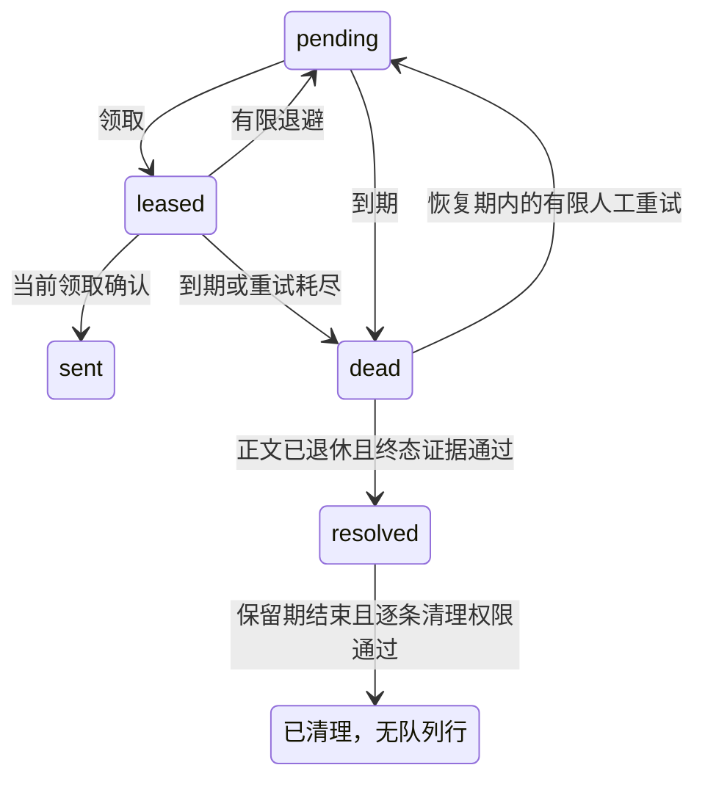

# Outbox超期消息对账处置

状态：R4.3 对账核心与原生接入候选。原生示例已实现签名证据、接收端持久取消、封存审计及显式 CLI，九版本地专项通过；完整 R4.3 尚未验收。库不会自行联网查询或根据暂时查不到记录推断远端未执行，核心 SQL 测试中的合成决策与原生签名证据测试分别记录。

## 终态与前提

超过恢复期的dead记录由维护清除正文后仍阻塞同聚合后续消息。处置须取得绑定原事件的终态依据：

- `received`：接收方持久业务账本已确认原事件、投递编号和正文摘要。
- `cancelled`：接收方已持久登记原事件的取消栅栏，后续普通投递也会被拒绝；暂时查不到记录不能证明已取消。

明确结论后调用 `SqlOutbox::reconcile(original, actor, outcome, evidenceDigest, decisionGuard)`。original必须来自宿主不可变业务数据的原始Message，不能改正文、创建时间或投递身份；evidenceDigest是已经验证的证据原文的SHA-256摘要。当前管理回调及显式decisionGuard都严格返回true才可处理。

核心仅接受超过recovery_age、status=dead且payload_present=0的已退休记录。处置结果为独立的 `resolved`，`Status::resolution()` 返回received或cancelled，sent_at保持0；旧领取凭据不能确认或修改它。相同证据／结论重复调用不更改终态，冲突结论或证据拒绝。



resolved解除同聚合阻塞，保留期内仍占容量。`maintain()`随后逐条调用管理动作purge_resolution的current／commit阶段，再删除该行；purged计数包括这些行，任何拒绝回滚本页全部清理。原事件已超过入队期，清理不能让它重新入队，根的last_order也不会复用。

## 宿主审计事务

与enqueue一样，reconcile只加入当前PDO上实际已开启的宿主事务，不开始、提交或回滚外层事务。正确顺序是：

审计表必须与Outbox具备一致的实际事务／耐久性保证；MySQL使用InnoDB，不能只凭同一个PDO就认为MyISAM、另一连接或临时表能参与原子持久提交。

1. 在SQL事务之外完成远端查询／签名验证／取消登记，得到已验证、绑定原事件的不可变证据；当前来源、密钥、目的端、租户及期限都必须匹配。
2. 开启宿主事务，在同一PDO持久写入有唯一事件约束的审计决定、证据摘要和必要的证据原文／归档引用。
3. 调用reconcile，decisionGuard从这个事务读取实际审计记录，核对当前操作者、原始指纹、投递编号、正文摘要、终态及证据摘要。若证据会到期，每次检查都重新核对期限。
4. 宿主明确COMMIT后才报告处置已提交。发生异常时中止整个业务单元；不能吞掉异常后单独提交审计或其他业务。

此处commit阶段是释放局部保存点之前的复核，不是宿主稍后COMMIT成功的钩子；宿主仍负责其最终提交结果和异常恢复。

返回true只是待宿主提交的转换；返回false只表示没有新转换，不能把缺失队列行解释为远端已接收。宿主须根据实际审计账本区分已完成、已归档和未知状态。

decisionGuard签名为 `function(phase, metadata): bool`，在request／current／commit三阶段同步调用，元数据为本地副本。request包含输入绑定，尚不证明队列中存在记录；后两阶段在存在记录时追加已认证的状态、顺序及次数。绑定包括site、epoch、scope、producer、actor、id、delivery_id、目的端／主题／聚合、原指纹／正文摘要／字节数／创建时间、outcome及evidence_digest。

管理与决策回调只做当前、有限的读取和验证，不联网、不修改审计／业务／Outbox、不控制事务，也不能复用一次检查得到的静态true。MySQL集成须使用适当的当前锁定读或条件校验，避免把旧一致性快照当作当前权限。核心检查保存点归属并复验完整Outbox历史；故意自行提交的宿主回调已经造成的副作用不能由库恢复。

清理resolved时，管理回调还会收到resolution、evidence_digest和payload_digest，须先确认宿主审计记录仍存在、完整且满足保留／归档策略。库不替宿主保存或删除审计正文，不能因队列行清理而一起清除独立审计依据。

## 封存格式升级

DDL及原有行字段不变。首次成功处置把该记录及命名空间根的已认证format推进为2；其他原始记录可以继续为1。新代码读取原格式，尚未处置的命名空间继续使用1。格式2根在所有处置行清理后仍保留2，不能手工改回1。

启用前须停止所有旧生产／发送／管理进程并切换到支持格式2的代码。旧代码严格拒绝格式2根，不能同时继续消费该命名空间；不能把这一变化描述为可直接回滚旧代码。宿主恢复／回滚还需核对业务审计、接收端取消栅栏与外部epoch，不能仅还原一个队列表。

公开候选仅向现有类追加SqlOutbox.reconcile及Status.resolution，原166类其他成员签名保持。诊断增加reconciliation_evidence、resolution_audit和format_rollout人工核实项，不查询数据库、调用权限回调或代替远端验收。

## 原生签名证据与命令

原生配置增加可选 `resolution_keys` 私有 JSON 文件，格式沿用 `current`／`keys`，最多 8 个有名称的规范 Base64 32 字节值。接收端保存 Ed25519 种子，发送端只保存对应验证公钥；不能把接收端种子复制给发送端。接收端签名种子不得复用封存或投递密钥。发送端另显式配置 `receiver_epoch`，绑定当前可信接收部署。签名操作要求 sodium；普通收发未配置对账时不加载对账密钥或调用签名函数。[PHP 原生 Ed25519 签名接口](https://www.php.net/manual/en/function.sodium-crypto-sign-detached.php)提供对应原语，当前命令使用本示例专用协议。

发送管理账号同时具备 `outbox_admin` 与 `outbox_reconciler`，接收管理账号同时具备 `receiver_admin` 与 `receiver_reconciler`。每次核对实际账号启用状态、版本、当前角色和原事件关联。关闭已禁用的历史账号／路由可以处理，但其租户、发布者和归属记录仍必须存在且匹配；普通接收继续要求当前启用和工作权限。

升级先停旧进程并备份业务库、独立检查点、外部配置及密钥。新建示例库使用完整示例 DDL；已有库分别由宿主迁移执行 [发送端增量 DDL](../resources/sql/outbox-example-resolution-sender-sqlite.sql) 和 [接收端增量 DDL](../resources/sql/outbox-example-resolution-receiver-sqlite.sql)，不能向已有库重跑完整建表脚本。首次取消将接收业务根推进为格式 2，已接收历史的摘要保持原算法；旧进程不支持格式 2，不能直接回退旧代码或仅还原取消表。

在两端分别设置自己的 `SOSECURITY_OUTBOX_EXAMPLE_CONFIG`，使用对应私有配置执行：

```sh
# 接收端：只导出公钥，交由发送端部署者核验后安装为私有公钥配置。
php examples/outbox-receiver-admin.php --public-keys
# 发送端：显式初始化审计根，已存在则不重置。
php examples/outbox-admin.php --initialize-resolution
# 发送端：先维护到原 dead 消息正文已退休，再导出原事件绑定请求。
umask 077
php examples/outbox-admin.php --export-resolution="$EVENT_ID" > request.json
# 接收端：已存在实际终态时签发；未知事件会拒绝。
php examples/outbox-receiver-admin.php --attest=/private/request.json > receipt.json
# 接收端：确需取消时单独执行，先持久登记栅栏再签发，已接收事件拒绝取消。
php examples/outbox-receiver-admin.php --cancel=/private/request.json > receipt.json
# 发送端：导入原始签名证据，原子提交审计和处置，再查询实际结果。
php examples/outbox-admin.php --import-resolution="$EVENT_ID" /private/receipt.json
php examples/outbox-admin.php --resolution-status="$EVENT_ID"
```

命令仅限 CLI，导入无副作用；HTTP 直接访问管理脚本返回 404。输入文件须为 Web 根外、规范路径的私有文件及私有父目录；请求最多 12000 字节、证据最多 4096 字节。Shell 重定向前设置私有 umask，跨端传递使用宿主受控通道，不能上传到公开目录。请求文件本身不证明发送方身份，接收管理员须核对受控来源和原事件后才执行取消；命令不联网传送文件或自动信任导出的公钥。

请求挑战在发送端封存审计中创建一次，重复导出保持原挑战、正文及投递编号。证据签名包含固定站点／作用域／生产者、原事件／投递／正文摘要和指纹、挑战、目的端摘要、接收 epoch、已提交业务根摘要和序号，期限为 300 秒。首次导入及事务各检查阶段验证当前信任公钥、所有绑定和有效期；同事件的新签名不能覆盖已接受证据。更改目的端或接收 epoch 不自动改写待处理挑战，须由部署者对账后受控迁移。

取消是永久业务终态，参与接收业务根和独立检查点历史；迟到的普通投递在创建新的接收历史或执行业务前被拒绝。取消提交中断沿用 [接收恢复](outbox-recovery.md)：普通请求拒绝未完成检查点，受控恢复只补回已封存的最后一个转换。恢复取消还需要当前对账管理权限及原始关联，不依赖签名私钥仍在线。部分表恢复、过早备份或缺少权威关联均不能自动确认。

发送审计根绑定完整有序记录集合，分页最多 64 条并验证在线封存，在线最多 1000 条，每条读取上限 8192 字节。新增可选[同库历史归档与分页重封存](outbox-audit-archive.md)：显式迁移和启用后，发送审计根升级为格式 2，最多保留 100000 条完整历史；只移出已完成且队列已清理的记录，不删除原证据，满额仍拒绝。对账状态与证据、公钥快照、操作者及验证时间同 PDO 提交；COMMIT 结果不明时重新查询／重复导入原证据，不能产生新事件或另换证据。维护清理队列行前逐条复核封存审计，审计缺失或异常即拒绝清理。

已完成状态的查询和清理使用封存的公钥快照复核原签名及当时验证时间，因此不要求证据一直不过期或旧在线公钥一直保留；首次导入仍严格使用当前公钥。审计、业务表和队列全部同时恢复旧快照不能单靠数据库内 HMAC 检出，宿主仍须保留外部恢复基线／epoch、当前权限来源和完整备份策略，不能把本地封存视为远端审计服务。

## 验证及尚未完成

`tests/outbox-reconciliation.php`使用合成审计决定和真实PDO事务，核对提交／回滚、当前管理／决策拒绝、原指纹冲突、终态幂等与冲突、顺序与容量、旧领取、逐条清理、回调元数据副本，以及SQLite大字段／NUL异常读取。`tests/outbox-reconciliation-concurrency.php`另用24个真实子进程竞争相同／冲突决定，并在宿主审计与处置COMMIT前后实际SIGKILL，观察独立连接及恢复结果。全部数据库为自己创建的本地临时库。

`tests/outbox-resolution.php` 使用本地真实 Ed25519 密钥和私有 SQLite，原意图测试数据通过受控过去时钟创建，签名及原生对账使用当前实际时间。覆盖实际已接收／已取消两条链路、绑定与时效拒绝、撤销在线公钥后历史查询、SQL 语句及 COMMIT 前后故障、取消备份恢复、缺失审计禁止清理、16MiB NUL 字段与实际 CLI。业务权限和数据均为本地测试预设，不代表生产发行方或外部对账验收。

同库审计归档及重封存已完成本地九版专项，字段读取限制、容量、外键依赖及实际查询计划均有复验；权威恢复对接、全阶段最终门禁及其他 R1—R6 要求保持未完成状态。已执行结果、失败记录与快照见[验证记录](verification.md)。

本轮原生候选九版每版 279 项新对账／342 项接收恢复／66 项适配、独立协议互验各 17 项通过；两版实际 TLS 各 318、新消费者、319 文件归档、API／语法与静态检查通过。新增六阶段真实 SIGKILL、实际增量 DDL 及两版真实旧源码的格式 1 兼容／格式 2 拒绝证据，详见验证记录。仍无生产、外部发行方或独立审查结论。

本地阶段九版PHP7.2—8.5对账核心SQLite各274／MySQL各268、两后端并发各31项通过；两版全新消费者实际调用新接口及回滚／提交，旧解析器拒绝格式2而不改写根，316文件归档及接口兼容比较通过。原生网络预算的补充复验另有九版各66适配／342恢复／318 TLS，保留首轮失败与分阶段SHA，不把这一链路回归当作已实现原生对账证据。
